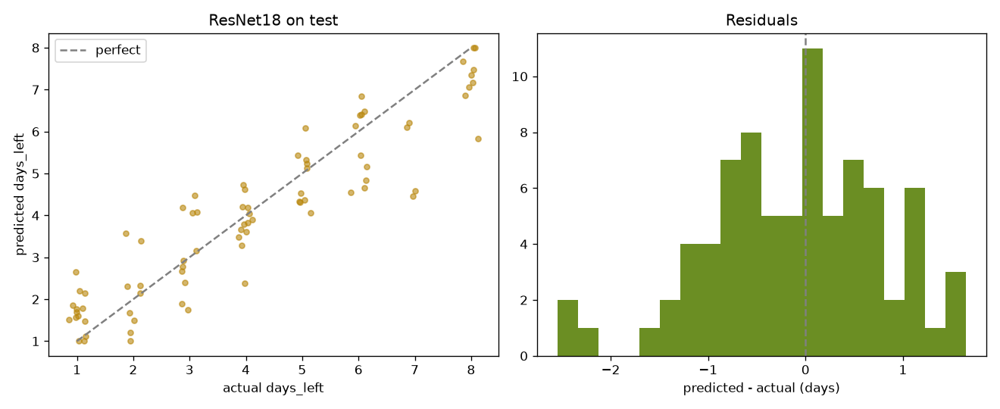

# BananaLife 🍌

Upload a photo of a banana and a ResNet18 regression model estimates where it sits on an 8-step scale from fresh to overripe.

**Live app:** [gogojo.github.io/BananaLife](https://gogojo.github.io/BananaLife/). The model runs in your browser with ONNX Runtime Web, so photos never leave your device.

## Results

Test set: 80 held-out photos, split so that no photo or near-copy of it appears in training.

| Model | MAE (days) | RMSE | R² |
| --- | --- | --- | --- |
| Always predict the training mean | 1.87 | 2.24 | 0.00 |
| Ridge regression on HSV color histograms | 1.26 | 1.66 | 0.45 |
| **ResNet18, fine-tuned** | **0.71** | **0.89** | **0.84** |



## What the label means

The training data is the CC0 Kaggle dataset [Days-death-to-a-banana](https://www.kaggle.com/datasets/anishkumar00/days-death-to-a-banana). Its `days_left` column is the day number in each filename, rewritten (`days_left = 9 - day`). It was not measured separately. The photos that share a "banana number" are unrelated shots, not one banana photographed over time. So the model predicts this dataset's ripeness index, not measured edible shelf life. [docs/phase1_dataset_report.md](docs/phase1_dataset_report.md) has the full audit.

To avoid leakage, the pipeline:

- links byte-identical files and near-copies (difference hash within 4 bits) into groups
- drops groups whose copies carry different labels (19 exact-copy groups did)
- splits by group with `StratifiedGroupKFold`, so the label mix is similar across train, validation, and test

That leaves 398 of 471 images: 254 for training, 64 for validation, and 80 for testing.

## Repository layout

| Path | Contents |
| --- | --- |
| `ml/` | Data audit, PyTorch dataset, model, training, evaluation, baselines, ONNX export, tests |
| `backend/` | FastAPI prediction API (`POST /api/v1/predictions`) with upload validation and tests |
| `frontend/` | React + TypeScript + Vite + Tailwind web app |
| `docs/` | Dataset exploration report |

## Running it locally

Python 3.11 and Node 20.

```bash
python3 -m venv .venv
.venv/bin/pip install -r ml/requirements.txt -r backend/requirements.txt onnx onnxruntime
.venv/bin/pip install -e ml
```

Rebuild the model. You need the Kaggle extract in `ml/data/raw/`, or set `BANANA_DATA_DIR`.

```bash
.venv/bin/python -m bananalife_ml.manifest      # clean, group, and split -> ml/data/processed/manifest.csv
.venv/bin/python -m bananalife_ml.baseline      # mean and color-histogram baselines
.venv/bin/python -m bananalife_ml.train         # -> ml/checkpoints/best.pt
.venv/bin/python -m bananalife_ml.evaluate      # -> ml/reports/
.venv/bin/python -m bananalife_ml.export_onnx   # -> frontend/public/model/, checked against PyTorch
```

Run the web app with the model in the browser:

```bash
cd frontend && npm install && npm run dev
```

Or run it against the API:

```bash
cd backend && ../.venv/bin/uvicorn app.main:app --port 8000
cd frontend && VITE_INFERENCE_MODE=api npm run dev
```

Tests:

```bash
cd ml && ../.venv/bin/python -m pytest
cd backend && ../.venv/bin/python -m pytest
cd frontend && npm test
```

## Deployment

Every push to `master` runs `.github/workflows/deploy-web.yml`. It tests and builds the web app and publishes it to GitHub Pages. The FastAPI backend isn't deployed. The planned mobile app will need it hosted (for example on Render, Fly.io, or Hugging Face Spaces) or will need to run the model on the device.
